

  <a href="roles/daikenja/">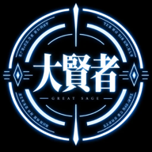</a>
  <a href="roles/gunshi/">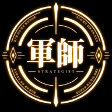</a>
  <a href="roles/tankyuusha/">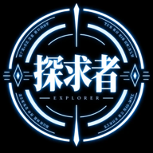</a>
  <a href="roles/zoukeishi/">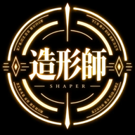</a>
  <a href="roles/kajishi/">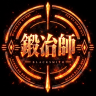</a>
  <a href="roles/kanteishi/">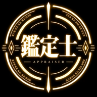</a>
  <a href="roles/tsukaima/">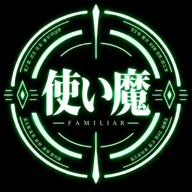</a>

<h1 align="center">agent-guild</h1>

  <b>AIエージェントのチームを「ギルド」として組むための設計図</b> 
  26の職業（役割）ごとの指示・紋章・スキル候補と、チームを組むための編成レシピ。

  <a href="#入団の手順">入団の手順</a> ·
  <a href="#編成レシピ">編成レシピ</a> ·
  <a href="#ギルド名簿">ギルド名簿</a> ·
  <a href="#ギルドの掟">ギルドの掟</a> ·
  <a href="#ファイルの地図">ファイルの地図</a>

↑ 上に並んでいるのは、最初のパーティ（small-team）の7人です。

---

## これは何？

- **何が入っているか**：エージェント1人ずつの指示の全文（`instructions.md`）、役割の設定（`role.yaml`）、アイコン（`avatar.png`）、チームの分け方、まとめて組むためのレシピ。
- **誰向けか**：エージェントを何人も並べて仕事をリレーさせるアプリ（OpenBot、Mausbot など）で、チームを一から組む手間を省きたい人。
- **どこが違うか**：指示もスキルの選び方もファイルで読めます。利用アプリの機能に合わせて、役割と手順を移し替える設計です。
- **なぜ公開しているか**：これから広がりそうな、エージェントが仕事をリレーする型のアプリ向けに、実際に動かしているチームの設定を保管し、参考として公開しています。
- **スキルはOSSが基本**：エージェントに持たせるスキルは、特定のアプリの専用品ではなく、公開されているOSSを基本にしています。アプリを替えても同じ設計を持ち込めるようにするためです。

一括インストーラーではありません。アプリごとの手順を読み、役割と必要なスキルを選んで設定します。

## 入団の手順

1. **パーティを選ぶ** — [編成レシピ](#編成レシピ)から、7人の `small-team` か、26人の `full-guild` を選ぶ。
2. **エージェントを作る** — [`adapters/`](adapters/) にある、使っているアプリの手順に従う。指示は各役割の `instructions.md` をそのまま貼る。
3. **自分の冒険に合わせる** — 指示の最後の「使う人が埋めるところ」を、自分のプロジェクトに合わせて書き足す。大賢者には作業を記録する課題管理の場所も指定する。まだ決まっていなければ会話内で作業状況をまとめ、記録先が必要になった段階で確認する。
4. **装備（スキル）を選ぶ** — 各役割の `skills` と `optional_skills` を共通の候補として、`skill_usage` で用途を確かめる。OpenBotでは `openbot.skill_overrides` にある既存スキルも確認し、使える場合だけ重複する候補の追加を省く。詳しくは [`skills/README.md`](skills/README.md) の手順に従う。

> [!TIP]
> 迷ったら `small-team` から。差配・計画・調査・制作・開発・レビュー・画面操作がそろう、小さな編成です。

## 編成レシピ

| パーティ | 人数 | 向いている使い方 |
|---|---|---|
| 🛡️ [`small-team`](recipes/small-team/recipe.yaml) | 7人 | まず小さく始める。差配・計画・調査・制作・開発・レビュー・画面操作 |
| 🏰 [`full-guild`](recipes/full-guild/recipe.yaml) | 26人 | 運営から営業までそろえる |

役割の指示と編成レシピは、下の開発の流れをおすすめの設計として書いています。モデル名は例です。利用先で使えるものを選んでください。

`small-team` のおすすめの開発の流れ（モデルは例）：

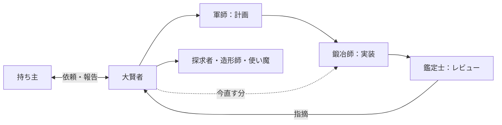

情報の調査は探求者、制作は造形師、画面操作は使い魔へ。大賢者が結果を取りまとめて持ち主に報告し、レビューの指摘は「今直す／後でよい／直さない（やりすぎ）」に仕分けて、今直す分だけ鍛冶師へ返します。

この設計図を作った理由

エージェントを何人も並べて仕事をリレーさせるアプリ（OpenBot、Mausbot など）は増えています。ただ、使い始めると、まずチームを一から組む手間がかかります。誰に何を任せるか、どんな指示を書くか、どのスキルを持たせるかを、全部自分で決めなければなりません。

公開されているbotのマーケットプレイスもあります。ただ、多くはそのアプリの中でしか使えず、指示やスキルの中身も見えません。

このリポジトリは、チームの組み方をファイルとして公開します。どのアプリを使っていても、同じチームを組めるようにするのが目的です。

## ギルド名簿

5つの部署に26の職業。紋章を押すと、その役割のファイル（指示・設定・アイコン）が開きます。

### 運営　ギルドを回す

<table>
  <tr>
    <td align="center" valign="top">
       
      <b>大賢者</b> 
      Great Sage 
      差配役
    </td>
    <td align="center" valign="top">
      <a href="roles/denrei/">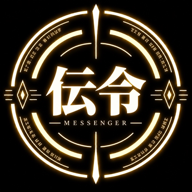</a> 
      <b>伝令</b> 
      Messenger 
      外部チャットの取り次ぎ
    </td>
    <td align="center" valign="top">
       
      <b>使い魔</b> 
      Familiar 
      画面操作
    </td>
  </tr>
  <tr>
    <td align="center" valign="top">
      <a href="roles/shoukanshi/">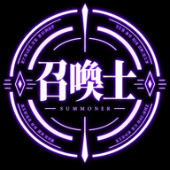</a> 
      <b>召喚士</b> 
      Summoner 
      エージェントとスキルの設計
    </td>
    <td align="center" valign="top">
      <a href="roles/renkinjutsushi/">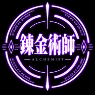</a> 
      <b>錬金術師</b> 
      Alchemist 
      手順書と自動化
    </td>
    <td align="center" valign="top">
      <a href="roles/shokikan/">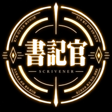</a> 
      <b>書記官</b> 
      Scrivener 
      会議の記録
    </td>
  </tr>
</table>

### 企画・調査　地図を描く

<table>
  <tr>
    <td align="center" valign="top">
       
      <b>軍師</b> 
      Strategist 
      計画
    </td>
    <td align="center" valign="top">
       
      <b>探求者</b> 
      Explorer 
      調査
    </td>
    <td align="center" valign="top">
       
      <b>占星術師</b> 
      Astrologer 
      施策の分析
    </td>
  </tr>
  <tr>
    <td align="center" valign="top">
      <a href="roles/zaimukan/">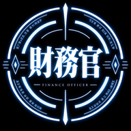</a> 
      <b>財務官</b> 
      Finance Officer 
      経理
    </td>
    <td align="center" valign="top">
      <a href="roles/sokuryoushi/">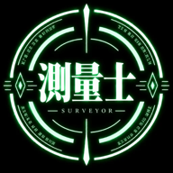</a> 
      <b>測量士</b> 
      Surveyor 
      検索対策
    </td>
    <td align="center" valign="top">
      <a href="roles/monomi/">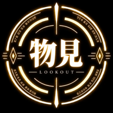</a> 
      <b>物見</b> 
      Lookout 
      競合の見張り
    </td>
  </tr>
</table>

### 制作　形にする

<table>
  <tr>
    <td align="center" valign="top">
       
      <b>造形師</b> 
      Shaper 
      画面とLP
    </td>
    <td align="center" valign="top">
      <a href="roles/choukokushi/">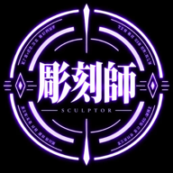</a> 
      <b>彫刻師</b> 
      Sculptor 
      3D
    </td>
    <td align="center" valign="top">
      <a href="roles/doukeshi/">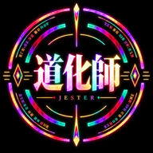</a> 
      <b>道化師</b> 
      Jester 
      遊び心のレビュー
    </td>
  </tr>
  <tr>
    <td align="center" valign="top">
      <a href="roles/kataribe/">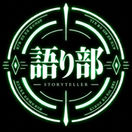</a> 
      <b>語り部</b> 
      Storyteller 
      記事
    </td>
    <td align="center" valign="top">
      <a href="roles/bunkan/">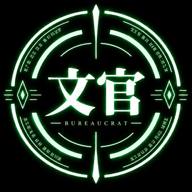</a> 
      <b>文官</b> 
      Bureaucrat 
      文書
    </td>
  </tr>
</table>

### 開発　鍛えて守る

<table>
  <tr>
    <td align="center" valign="top">
       
      <b>鍛冶師</b> 
      Blacksmith 
      実装
    </td>
    <td align="center" valign="top">
       
      <b>鑑定士</b> 
      Appraiser 
      レビュー
    </td>
    <td align="center" valign="top">
      <a href="roles/chiyushi/">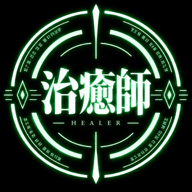</a> 
      <b>治癒師</b> 
      Healer 
      不具合の調査
    </td>
  </tr>
  <tr>
    <td align="center" valign="top">
      <a href="roles/kekkaishi/">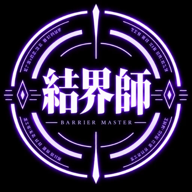</a> 
      <b>結界師</b> 
      Barrier Master 
      安全性
    </td>
    <td align="center" valign="top">
      <a href="roles/kishu/">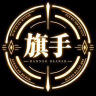</a> 
      <b>旗手</b> 
      Banner Bearer 
      リリース
    </td>
  </tr>
</table>

### 営業・広報　外とつなぐ

<table>
  <tr>
    <td align="center" valign="top">
      <a href="roles/sekkou/">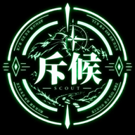</a> 
      <b>斥候</b> 
      Scout 
      商談の下調べ
    </td>
    <td align="center" valign="top">
      <a href="roles/ginyuushijin/">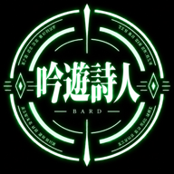</a> 
      <b>吟遊詩人</b> 
      Bard 
      営業の文面
    </td>
    <td align="center" valign="top">
      <a href="roles/annainin/">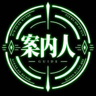</a> 
      <b>案内人</b> 
      Guide 
      問い合わせの返事
    </td>
  </tr>
  <tr>
    <td align="center" valign="top">
      <a href="roles/shikenkan/">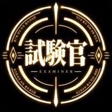</a> 
      <b>試験官</b> 
      Examiner 
      採用面接
    </td>
  </tr>
</table>

## ギルドの掟

> [!IMPORTANT]
> **一、振り分けと取りまとめは、差配役（大賢者）だけが行う。**
> 持ち主の依頼は差配役が受け、いちばん合う担当に振り、結果をまとめて報告する。
>
> **一、設計・実装・レビューを分担し、指摘は差配役が仕分ける。**
> モデルの例は、設計・計画・別の見方での確認が Claude（Opus）、実装・不具合の調査が GPT-6.1-Sol。レビューも GPT-6.1-Sol を使う別のレビュー役が担当し、差配役が「今直す／後でよい／直さない（やりすぎ）」に仕分け、必要なものだけ実装の担当へ渡す。
>
> **一、持ち主の一言が要る操作がある。**
> 支払い、持ち主の名前での送信や投稿、データの削除、秘密や権限の扱い、公開、取り消せない操作は、持ち主が言うまでしない。

ふつうの開発は、設計・計画→実装→別のレビュー役が細かく確認→差配役が仕分け→必要な修正の順です。条件が絡むバグは、調査→別の見方で確認→修正→レビュー→仕分けの順で進めます。不具合の原因調査は、`full-guild` では治癒師が担います。治癒師のいない `small-team` では鍛冶師が兼務し、修正前に再現して原因を確かめます。原因調査が多いなら治癒師を追加してください。指示の本文は役割で書いており、特定のモデルには依存しません。

## ファイルの地図

| 場所 | 中身 |
|---|---|
| `roles/<役割>/instructions.md` | エージェントへの指示の全文。アプリの設定にそのまま貼れる |
| `roles/<役割>/role.yaml` | 役割の説明、部署、モデルの例、共通のスキル候補。`openbot` にはモデルの実設定と、その環境で確認するスキルの置き換え |
| `roles/<役割>/avatar.png` | 紋章（PNG、512×512） |
| `docs/assets/emblems/<役割>.png` | README表示用の紋章（192×192）。元のアイコンから縮小したもの |
| [`sections.yaml`](sections.yaml) | チームの分け方（運営・企画・調査・制作・開発・営業・広報） |
| [`skills/catalog.yaml`](skills/catalog.yaml) | 調査した43スキル。取得元・固定した版・適用ライセンス・必要な環境 |
| [`skills/README.md`](skills/README.md) | 主候補と条件付き候補の読み方、導入時の手順 |
| [`docs/oss-skill-assignment.md`](docs/oss-skill-assignment.md) | 26人の割り当て一覧と、選定した理由・残る課題 |
| [`tools/sync_skill_assignments.py`](tools/sync_skill_assignments.py) | 役割ファイルから割り当て表を更新し、参照や一覧のずれを確認する保守用ツール |
| [`recipes/`](recipes/) | チームをまとめて組むためのレシピ |
| [`adapters/`](adapters/) | アプリごとの組み方 |

## スキル（装備）について

26人の役割に合わせ、43件のOSSスキルを共通の導入候補として記録しています。取得元の本文と適用ライセンスを同じコミットで確認し、各役割の `role.yaml` に主候補・条件付き候補・用途をまとめました。OpenBotで既存スキルを使う場合の置き換えは、その役割の `openbot.skill_overrides` に分けてあります。

くわしく（条件付きの候補、確認の状況）

- 原文の転送だけを担う伝令は、スキルの追加なしです。
- 大賢者の並列委任と財務官の会計スキルは、条件付きの候補です。
- 使い魔のブラウザ操作・画面取得スキルは Mausbot など別のアプリ向けで、OpenBot では使いません。
- OpenBotで重複を省くときは、置き換え先のスキルが利用環境にあり、用途と利用条件が合うことを確認します。確認できなければ共通のOSS候補を使います。Mausbotなど別のアプリにはOpenBot用の置き換えを適用しません。
- このリポジトリにはスキル本体を同梱していません。各候補の固定版と確認日は `skills/catalog.yaml` に記録しています。アプリへの導入状況は利用環境によって異なります。この設計図だけで動作を保証するものではありません。割り当てを使う前に、必要なファイルとアプリごとの対応を確かめてください。

全員の割り当てと選定理由は [`docs/oss-skill-assignment.md`](docs/oss-skill-assignment.md) にあります。

表示用の紋章は `roles/<役割>/avatar.png` から縮小しています。

**紋章の画像について**

`docs/assets/emblems/` と `roles/<役割>/avatar.png` の紋章は、OpenAI の ChatGPT（画像生成）で作成した画像です（人の手で描いたものではありません）。作者は、これらの画像に著作権その他の権利がある場合、その範囲で [CC0 1.0](https://creativecommons.org/publicdomain/zero/1.0/deed.ja) により放棄します（全文は [`docs/assets/emblems/CC0-1.0.txt`](docs/assets/emblems/CC0-1.0.txt)）。コードと文書は MIT License です。画像は現状のまま提供し、他の作品や商標と似ていないことは保証しません。

## ライセンス

[MIT](LICENSE)。紋章の画像は [CC0 1.0](docs/assets/emblems/CC0-1.0.txt)（上の「紋章の画像について」）。スキルは、それぞれのリポジトリのライセンスに従います。

⚔️ ようこそ、ギルドへ。最初の依頼は、パーティ選びから。

